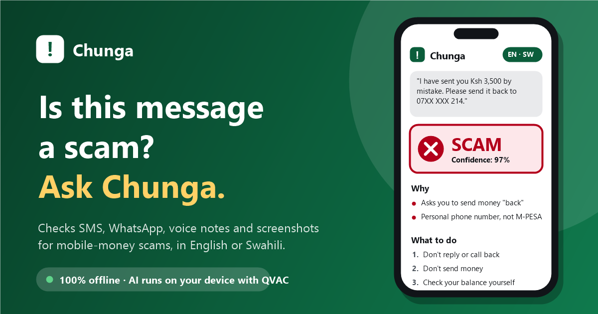
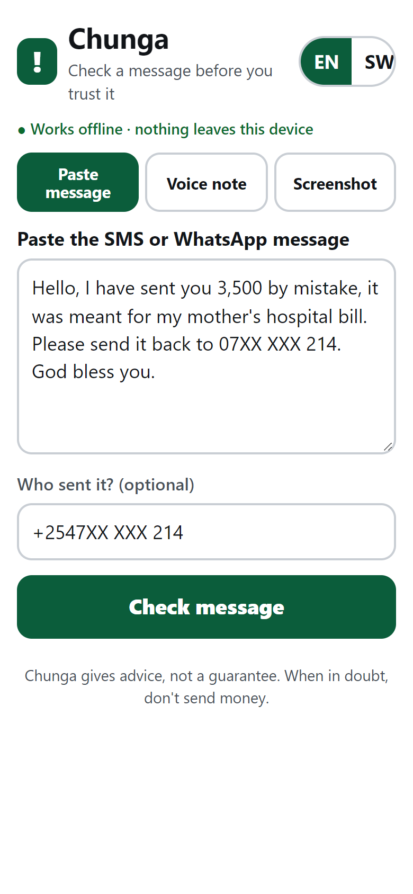
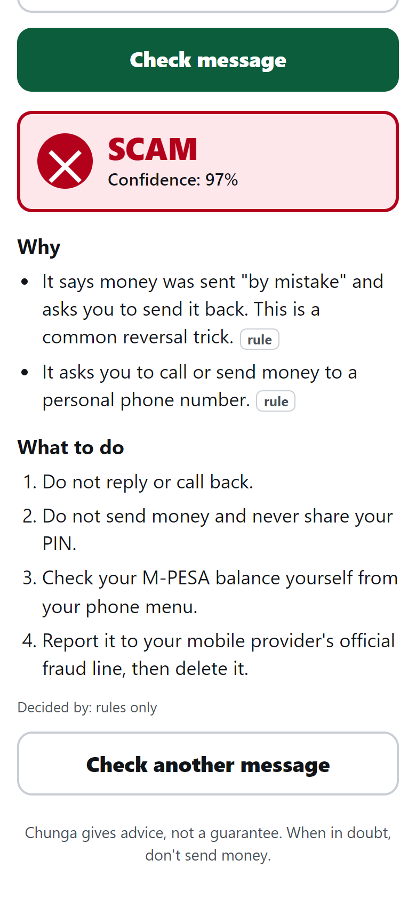
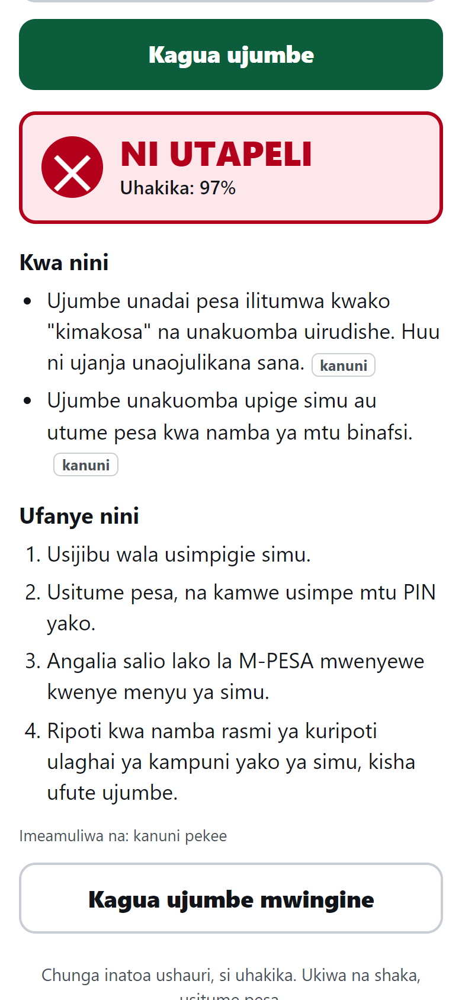
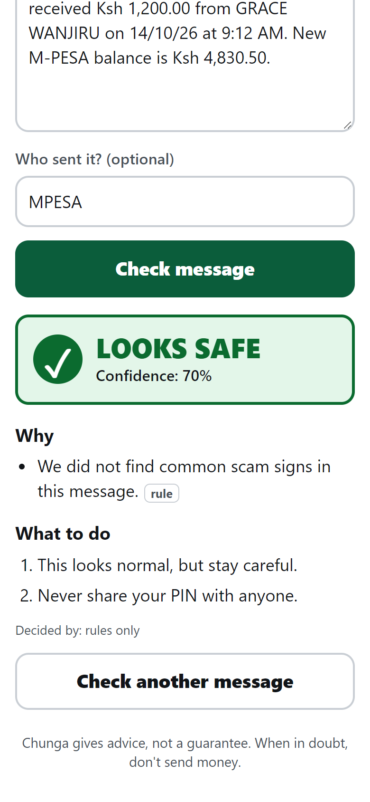
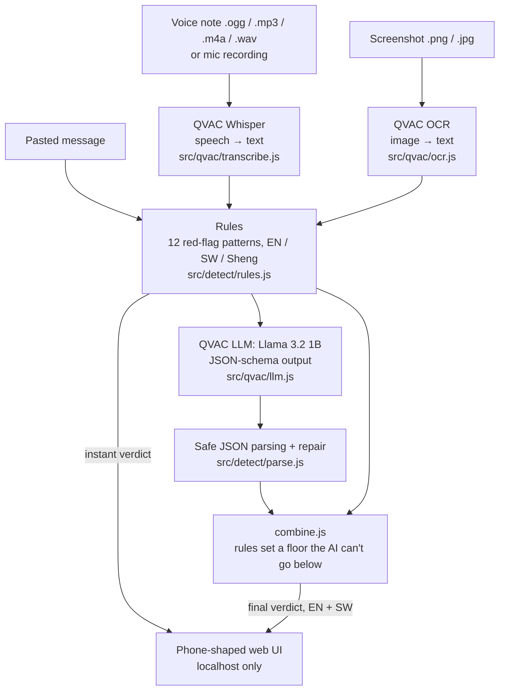

# Chunga – offline scam checker for mobile money



**Chunga** ("watch out" in Swahili) tells you whether an SMS, WhatsApp message or
voice note is a mobile-money scam, explains why in simple English or Swahili,
and tells you what to do next.

**All AI runs on your own computer with [QVAC](https://docs.qvac.tether.io).** No cloud AI, no
accounts, no data leaves the device. After a one-time model download, it works
with Wi-Fi off.

> Hackathon: **AI Yako: Own Your AI** (QVAC by Tether, DoraHacks) · Track: **Offline AI apps**

---

## The problem

Mobile money is how most people in Kenya send, receive and save money, and
that makes its users a target for fraud. Common tricks include:

- **Fake reversals:** "I sent you money by mistake, please send it back." The
  first SMS is a fake M-PESA receipt; no money ever arrived.
- **Fake Safaricom agents:** a caller asks for "the code we just sent" or your
  M-PESA PIN, and then empties the account.
- **Fake prizes, loans and jobs:** you "won" or "qualified", but must pay a fee first.
- **Phishing links** and **"new number" messages** from someone pretending to be a relative.

The people hit hardest are often older users, first-time smartphone owners and
people who read English or Swahili with difficulty. They also tend to be the
people with the least data and the least trust in cloud apps.

## Who it helps

- Older relatives who get a scary message and don't know whether to trust it.
- Low-literacy users: large buttons, short sentences, colours **and** icons and
  words for each verdict, Swahili or English.
- Anyone who doesn't want their private messages sent to a cloud service.
  Chunga runs entirely on the device, offline.

## Features

| Feature | Status |
|---|---|
| Paste an SMS / WhatsApp message (English, Swahili, Sheng) | ✅ Working, tested offline |
| Verdict **SCAM / SUSPICIOUS / LOOKS SAFE** with a confidence level | ✅ |
| 2–3 plain-language reasons, each labelled *rule* or *AI* | ✅ |
| What to do next (hand-written advice, no hotline numbers invented) | ✅ |
| English / Swahili toggle (switches instantly, no re-check) | ✅ |
| Instant answer from the rules, then the offline AI double-checks | ✅ |
| Voice note upload (.ogg/.opus, .mp3, .m4a, .wav) + record from mic, transcribed offline with QVAC Whisper | ⚠️ Built; **needs a CPU with AVX2** (see [Known limitations](#known-limitations)) |
| Screenshot of a message (.png / .jpg), read offline with QVAC OCR | ✅ Working; slow on old CPUs (7.5 min per screenshot on our test laptop) |
| Read the verdict aloud in Swahili or English (QVAC text-to-speech, Chatterbox multilingual), with every sentence cached after first use | ⚠️ Built; **needs a CPU with AVX2** (see [Known limitations](#known-limitations)) |

### Screenshots

| Fake reversal SMS pasted | SCAM verdict + red flags | Same result in Swahili | SAFE on a real M-PESA receipt |
|---|---|---|---|
|  |  |  |  |

Real screenshots of the app (headless Edge at 390×844, `npm run screenshots`),
taken with `CHUNGA_AI=off`, so they show the instant rules result ("Decided by:
rules only"). With the AI on, the same screen shows the AI's double-check when it finishes.

## How it works



**Why rules *and* AI?** A small model on an ordinary laptop can be wrong, and
on our test laptop it was. The rules are instant and predictable, so they set a
floor (`src/combine.js`):

1. **Strong rule hit** (asks for PIN/OTP, "send it back" reversal, fake
   customer-care number, fake M-PESA receipt from a phone number) → **SCAM**,
   whatever the AI says.
2. **Weak rule hits** (urgency, links, prize/loan/job wording) → at least
   **SUSPICIOUS**; the AI's confidence is raised.
3. **No rule hits** → trust the AI, but the AI alone can say at most
   **SUSPICIOUS**. In our eval the 1B model called normal family messages
   SCAM at 100%, so SCAM always needs a rule hit.
4. If the AI fails or its answer can't be read → rules only. The app never crashes on bad AI output.

Explanations and advice are hand-written in English and Swahili for every
reason code (`src/detect/messages.js`), so they are clear and correct even
though the model is small. The AI adds a one-line summary and can add red flags
the rules don't know. Those are in English only: in Swahili mode the summary is
hidden and AI flags are shown as one hand-written Swahili sentence, because the
1B model's Swahili was often wrong in our tests.

## Setup

**Needs:** Node.js ≥ 22.17, Windows 10+ x64 (also macOS / Linux per the QVAC
docs, untested by us), ~4 GB free disk (2.5 GB of npm packages, because the
QVAC SDK installs all its engines, plus ~0.9 GB of models), 4 GB RAM minimum
(8 GB recommended).

```powershell
git clone https://github.com/toluwalasedaniel459-cmyk/chunga.git
cd chunga
npm install
npm run check-cpu        # tells you if voice notes will work on this PC
```

### Download the models (once, while online)

```powershell
npm run setup-models     # LLM + Whisper base + VAD + OCR, about 960 MB
                         # -- --voice  adds the read-aloud models (~1.1 GB)
                         # -- --all    adds those plus Whisper small (better Swahili)
```

Models are stored in QVAC's cache (`~/.qvac/models`), not in this repo.

### Run (Wi-Fi can be off from here on)

```powershell
npm start                # http://localhost:3000
```

For voice notes on a PC with AVX2:

```powershell
$env:CHUNGA_AUDIO="on"; npm start
```

To read results aloud (also needs AVX2, and `setup-models -- --voice`):

```powershell
npm run prepare-voice    # once: generates all spoken sentences with QVAC
$env:CHUNGA_AUDIO="on"; $env:CHUNGA_TTS="on"; npm start
```

The first start shows "Loading AI…" while the model loads. Text checks already
work with the rules during that time.

### Other commands

| Command | What it does |
|---|---|
| `npm run eval` | Full eval on `data/test_messages.json` (rules + AI) |
| `npm run eval -- --rules` | Same, rules only (instant) |
| `npm run eval -- --audio` | Voice-note eval on `data/audio/` (needs `CHUNGA_AUDIO=on`) |
| `npm run eval -- --images` | Screenshot eval on `data/images/` (add `--rules` to skip the AI) |
| `npm run bench-ocr` | OCR speed test on one screenshot |
| `npm run make-images` | Re-create the synthetic test screenshots (offline) |
| `npm run check -- "message" [--sender "+2547…"] [--sw] [--rules]` | Check one message in the terminal |
| `npm run bench` / `npm run bench-whisper` | Speed tests for the LLM / Whisper |
| `npm run make-audio` | Re-create the synthetic test voice notes (Windows voices, offline) |
| `npm run smoke` | Minimal QVAC test: load the LLM and answer one question |
| `$env:CHUNGA_AI="off"; npm start` | Rules only, no LLM: instant answers, ~0.8 GB less memory |
| `npm run screenshots` | Re-take the README screenshots (app must be running) |

## QVAC usage

- **SDK:** [`@qvac/sdk`](https://www.npmjs.com/package/@qvac/sdk) **0.22.0**, pinned exactly in `package.json`.
- **APIs used:** `loadModel`, `completion` (streaming `events`, `responseFormat: json_schema`),
  `transcribe`, `downloadAsset`, `unloadModel`.

| File | QVAC usage |
|---|---|
| [`src/qvac/llm.js`](src/qvac/llm.js) | Loads the LLM once; `completion()` with a JSON schema so the model can only answer in our format; streams tokens; timing stats |
| [`src/qvac/transcribe.js`](src/qvac/transcribe.js) | Loads Whisper + Silero VAD once; `transcribe()` on uploaded files (QVAC decodes .ogg/.mp3/.m4a/.wav itself) |
| [`src/qvac/ocr.js`](src/qvac/ocr.js) | Loads OCR on the first screenshot; `ocr()` on PNG/JPEG/BMP; smaller detection canvas for low-memory laptops; fixes "O7XX" → "07XX" |
| [`src/qvac/tts.js`](src/qvac/tts.js) | Chatterbox multilingual (`language: sw` / `en`); `textToSpeech()` → WAV; caches each fixed sentence in `tts-cache/` |
| [`scripts/prepare-voice.js`](scripts/prepare-voice.js) | Pre-generates all 23 spoken sentences per language before a demo |
| [`scripts/setup-models.js`](scripts/setup-models.js) | `downloadAsset()` for every model, with retries |
| [`scripts/smoke-test.js`](scripts/smoke-test.js) | Minimal `loadModel` + `completion` check |

### Models

| Use | QVAC constant | Size | Licence |
|---|---|---|---|
| Classification + explanation | `LLAMA_3_2_1B_INST_Q4_0` (Llama 3.2 1B Instruct, Q4_0 GGUF) | 773 MB | [Llama 3.2 Community License](https://www.llama.com/llama3_2/license/) |
| Speech to text | `WHISPER_BASE_Q8_0` (Whisper base, multilingual, Q8_0) | 82 MB | [MIT](https://github.com/openai/whisper/blob/main/LICENSE) |
| Speech to text (optional, better Swahili) | `WHISPER_SMALL_Q8_0` | 264 MB | MIT |
| Voice-activity detection | `VAD_SILERO_5_1_2` (Silero VAD 5.1.2) | 1 MB | [MIT](https://github.com/snakers4/silero-vad/blob/master/LICENSE) |
| Read aloud (optional, `--voice`) | `TTS_T3_MULTILINGUAL_CHATTERBOX_Q4_0` + `TTS_S3GEN_MULTILINGUAL_CHATTERBOX_Q4_0` (Chatterbox multilingual, 23 languages incl. Swahili) | 345 MB + 788 MB | [MIT](https://github.com/resemble-ai/chatterbox/blob/master/LICENSE) |
| Screenshot text reading | `OCR_LATIN` (EasyOCR Latin recognizer) + CRAFT text detector, fetched automatically by QVAC | 15 MB + 83 MB | [Apache-2.0](https://github.com/JaidedAI/EasyOCR/blob/master/LICENSE) (EasyOCR; CRAFT weights are distributed with EasyOCR) |

**Built with Llama.**

**RAM:** we measured 0.76–0.86 GB for the QVAC worker with the LLM loaded
(plus a few tens of MB for the Node server). Whisper base adds a little more
(not measured: it can't run on our test laptop). On a 4 GB laptop, close the
browser tabs you don't need; with only ~0.3 GB free, a check took 6–7 minutes
instead of ~2.5.

## Network use

| Needs a network? | |
|---|---|
| First model download (`npm run setup-models`) | **Yes**, once |
| Everything else (loading models, checking text, voice notes, the UI) | **No** |

- The server listens only on `127.0.0.1`, so other devices can't reach it.
- Uploaded voice notes and screenshots are deleted right after they are read. See [PRIVACY.md](PRIVACY.md) for exactly what is and isn't stored.
- **Verified 2026-11-02:** with Wi-Fi off, the AI loaded from the local cache
  and a check finished with "rules + AI agree" (test laptop below).

## Tested on

| | |
|---|---|
| Device | Laptop, Intel Pentium 4417U (2 cores / 4 threads, **no AVX/AVX2**), Intel HD Graphics 610 |
| OS | Windows 10 Pro 10.0.19045, x64 |
| RAM | 4 GB (about 1 GB free in normal use) |
| Node.js | v26.10.0 |
| QVAC SDK | 0.22.0, LLM on CPU (the Intel GPU was slower) |

## Evaluation

Test set: [`data/test_messages.json`](data/test_messages.json), **36 synthetic
messages (23 scam, 13 safe)** in English, Swahili and Sheng that we wrote
ourselves. No real people's numbers or data; phone numbers are masked as `07XX XXX 123`.

| | Rules only | Rules + local AI |
|---|---|---|
| Exact accuracy | 97.2% (35/36) | **88.9%** (32/36) |
| **Scams marked SAFE** | **0 / 23** | **0 / 23** |
| Safe messages flagged | 0 / 13 | 4 / 13 (all SUSPICIOUS, none SCAM) |
| Avg / max time per message | < 1 ms | 152 s / 226 s |
| Avg time to first AI token | – | ~107 s |
| Model load (once per start) | – | 22–49 s |

Full results: [`data/eval_results.json`](data/eval_results.json),
[`data/eval_results_rules.json`](data/eval_results_rules.json). The rules + AI
run was split in two (the first run was stopped by low memory after 22
messages; the other 14 were run with `--only`) using identical code.

**How to read this honestly:**

- **The rules were written together with this test set**, so 97.2% is
  optimistic. When we tried 6 new messages, the rules missed 2 scams and raised
  1 false alarm; we fixed those and added the 6 to the set.
- On this set **the AI caught no scam that the rules missed**. Its value here is
  the summary sentence and catching wording the rules don't know, which a
  hand-made set can't measure well. It caused 4 SUSPICIOUS false alarms.
- **Speed:** the times above are for a CPU without AVX/AVX2. In the app the
  rules verdict appears **instantly**, and the AI's double-check follows.
  We expect a typical laptop with AVX2 to be several times faster, but have
  not measured that yet.

### Voice notes

5 synthetic clips in [`data/audio/`](data/audio/) (fake Safaricom agent, fake
reversal, fake loan, two normal messages), generated offline with the built-in
Windows voices. They are English-led, because no Swahili voice was available
offline. [`RECORDING_SCRIPT.md`](data/audio/RECORDING_SCRIPT.md) has Swahili /
Sheng versions to record with a phone.

| | Result |
|---|---|
| Transcription time, word error rate, verdict accuracy | **Pending: needs a PC with AVX2** (`npm run eval -- --audio`) |
| Rules on a perfect transcript of each clip | 5/5 correct (also 4/4 for the Swahili/Sheng scripts) |

### Screenshots

5 synthetic screenshots in [`data/images/`](data/images/) (fake reversal, fake
prize, Swahili PIN request, real-looking M-PESA receipt, family message), drawn
offline by `npm run make-images`.

| | Result (test laptop) |
|---|---|
| One screenshot (fake reversal), `npm run bench-ocr` | OCR load 22.3 s, **read 453.6 s**, 13 text blocks, rules verdict **SCAM** |
| What OCR got wrong | the transaction code (`SJK4H7XQ2P` → `SJKAHZXQZP`), `07XX` → `O7XX` (now fixed in code), one dropped "I" |
| Rules on a perfect reading of each screenshot | 5/5 correct |
| Full screenshot eval (`npm run eval -- --images`) | **Pending:** ~10 min per image on the test laptop |

## Known limitations

- **Voice notes need AVX2.** QVAC's speech engine
  (`@qvac/asr-ggml-win32-x64`, SDK 0.22.0) crashes on load with
  `0xC000001D` (illegal instruction) on our test CPU, on CPU and GPU, with
  Whisper tiny and base. The LLM engine ships an SSE4.2 fallback; the speech
  engine ships one build. That's why voice notes are off unless
  `CHUNGA_AUDIO=on`: a crash would also stop the LLM. `npm run check-cpu`
  tells you which case you're in.
- **Reading aloud needs AVX2 too.** QVAC's text-to-speech engine
  (`@qvac/tts-ggml-win32-x64`) also ships a single build, and its worker died
  every time it loaded a model on our test laptop (we tested the smallest one,
  Supertonic 3, 85 MB). It is off unless `CHUNGA_TTS=on`. Only our fixed,
  hand-written sentences are spoken (never the AI's free text), so each one is
  generated once and cached.
- **Slow on old CPUs:** about 2.5 minutes per AI check on the test laptop
  (longer when RAM is short). The rules answer instantly.
- **Small model:** Llama 3.2 1B can misjudge normal messages, which is why
  rules set the floor and the AI alone can't say SCAM.
- **Swahili speech:** Whisper tiny/base are weak on Swahili; `small` should be
  better (not yet measured by us).
- **Advice is generic:** we don't hardcode hotline numbers we haven't
  confirmed from an official source.
- The Swahili text was written by us and should be reviewed by a native speaker.

## Built during the hackathon

All code in this repository was written during the hackathon, with the help of
an AI coding assistant (Claude Code). No code was copied from other projects.

Third-party work we rely on:

- **QVAC SDK** (`@qvac/sdk` 0.22.0, Apache-2.0) and its bundled engines
  (llama.cpp-based LLM, whisper.cpp-based speech, FFmpeg audio decoding).
- **Models:** Llama 3.2 1B Instruct (Meta), Whisper (OpenAI), Silero VAD; see [Models](#models).
- **Microsoft Windows built-in voices** (System.Speech), used only to generate
  the synthetic test clips, not at runtime.
- The JSON-schema structured output and model loading follow the patterns in
  the official QVAC docs and SDK examples.

## Licence

MIT for the Chunga code (see [LICENSE](LICENSE)). Models and the QVAC SDK keep
their own licences (above).
